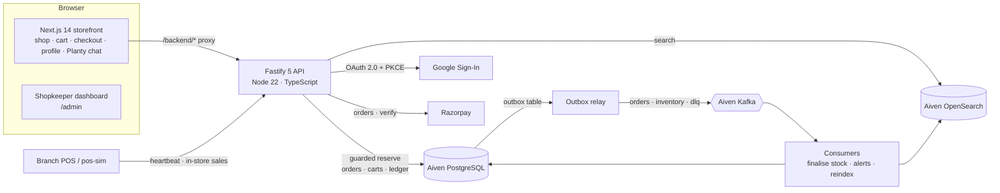
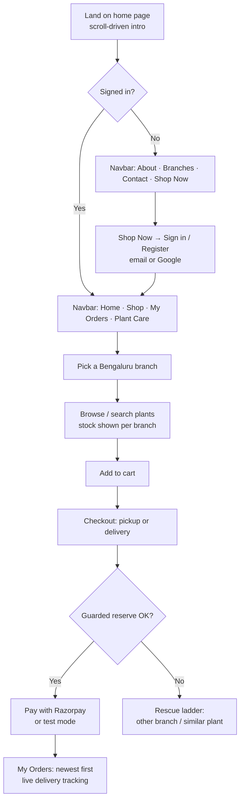
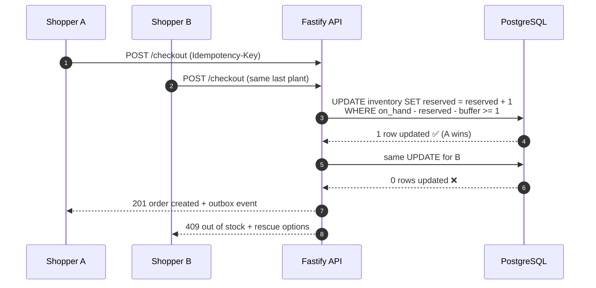
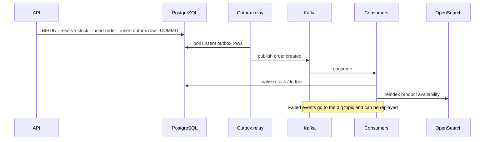
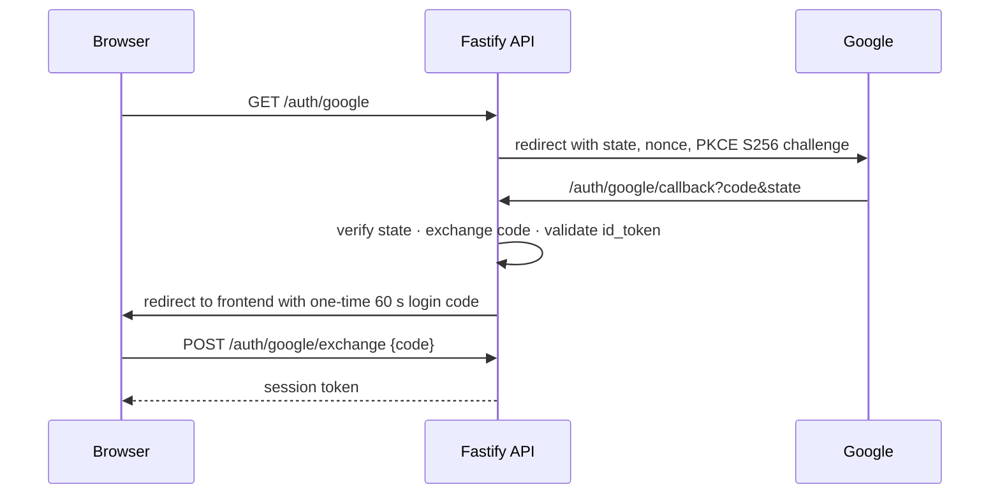
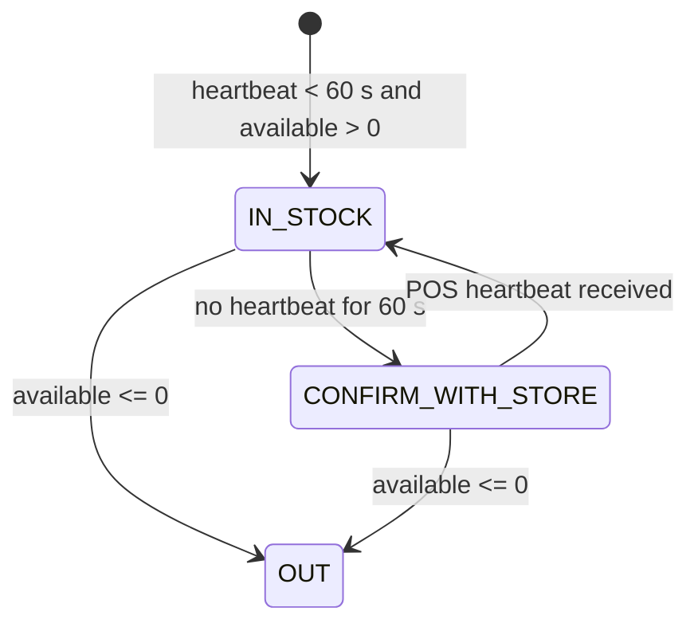

# 🌿 StockSure — Branch-Accurate Plant Nursery Store

> **Search is a hint. Checkout is a guarantee.**
> An online plant nursery for Bengaluru where the stock you see is the stock the branch really has, and two shoppers can never buy the same last plant.

Built by **Team DEV BYTES** (Jain University, FET) for the **Aiven "Build the Online Store" hackathon**.

[](https://github.com/ugesh13/StockSure/actions/workflows/ci.yml)


---

## 📌 Table of contents

1. [The problem](#-the-problem)
2. [What StockSure does](#-what-stocksure-does)
3. [Architecture](#-architecture)
4. [Workflows](#-workflows)
5. [Features](#-features)
6. [Repository structure](#-repository-structure)
7. [Run it locally](#-run-it-locally)
8. [Environment variables](#-environment-variables)
9. [Testing & verification](#-testing--verification)
10. [Real vs simulated](#-real-vs-simulated)
11. [Known limits](#-known-limits)
12. [Team](#-team)

---

## ❓ The problem

Online nurseries show one global "In stock" number. In reality each branch has its own shelves, walk-in customers buy plants that the website still shows, and two people checking out at the same time can both "buy" the last pot. The result is cancelled orders and lost trust.

## ✅ What StockSure does

| Promise | How it is kept |
|---|---|
| **Stock is per branch** | Every product shows availability at each of the Bengaluru branches, not a single global count. |
| **No overselling, ever** | Checkout reserves stock with one atomic PostgreSQL `UPDATE … WHERE on_hand - reserved - buffer >= qty`. If the row does not update, the plant is gone, so the order is refused. |
| **Honest freshness** | A branch whose POS has not sent a heartbeat for 60 s shows **Confirm with store** instead of a fake "In stock". |
| **Fast, forgiving search** | OpenSearch with Hindi/Kannada/scientific-name synonyms and typo tolerance (e.g. *tulsi*, *tulasi*, *Ocimum*), with a PostgreSQL `pg_trgm` fallback. |
| **Everything is an event** | Orders write to a transactional outbox, a relay publishes to Kafka, and consumers finalise stock and update search. |

---

## 🏗 Architecture



| Aiven service | Its real job |
|---|---|
| **PostgreSQL** | Source of truth: stock, carts, orders, ledger, outbox, sessions, shelf locations. |
| **Kafka** | `orders`, `inventory` and `dlq` topics. Events finalise stock, notify, update search and trigger back-in-stock alerts. |
| **OpenSearch** | Fuzzy multilingual product search, one document per product per branch. |

---

## 🔄 Workflows

### 1. Shopper journey



### 2. Checkout — why two people can't buy the last plant



### 3. Event pipeline (transactional outbox)



### 4. Google sign-in (redirect flow with PKCE)



### 5. Branch freshness



---

## ✨ Features

**Storefront (`Frontend/`, Next.js 14 + Tailwind + Framer Motion)**
- Scroll-scrubbed cinematic intro and a nursery-gate sign-in experience
- 53 real nursery plants with licensed photos, Hindi and Kannada names
- Branch selector with real Bengaluru branches and map links
- Cart drawer, checkout (pickup / delivery), Razorpay payment with a visible test mode
- Profile: order history (newest first), live delivery tracking, cancel order, addresses
- Context-aware navbar: different links when signed in vs signed out; hidden on sign-in screens
- **Planty**, a plant-care chatbot that recommends plants and adds them to the cart
- Plant care guides (watering, sunlight, soil, placement, beginner picks)
- Shopkeeper dashboard at `/admin`: inventory, add plant, stock history, orders, INR pricing

**Backend (repo root, Fastify 5 on Node 22, no build step)**
- Guarded-reserve checkout with idempotency keys
- Transactional outbox → Kafka → consumers, dead-letter queue with replay
- OpenSearch multilingual search with PostgreSQL fallback
- Branch heartbeat freshness, POS sales, staff restock/count, 3D shelf layout
- Email/password and Google OAuth 2.0 (PKCE) auth, rate limiting, Swagger docs
- Razorpay orders + signature verification (mock provider for zero-secret demos)
- Delivery fee by distance, delivery tracking, and a rules-based plant chatbot endpoint

---

## 📁 Repository structure

```
StockSure/
├── src/                 # Fastify API: routes, services, domain rules, Kafka, OpenSearch
├── scripts/             # migrate, seed, pos-sim, race-test, judge-demo, image pipeline
├── sql/                 # PostgreSQL migrations
├── test/                # zero-secret unit tests (run in CI)
├── data/                # nursery seed CSV, care/FAQ data, licensed plant images
├── Frontend/            # Next.js 14 storefront + shopkeeper dashboard
│   ├── src/app/         #   pages: /, /shop, /profile, /plant-care, /login, /admin …
│   ├── src/components/  #   navbar, cart, checkout, Planty chatbot, admin UI
│   ├── src/lib/backend.ts  # single typed client for the Fastify API
│   └── public/          #   plant photos, videos, images
├── .github/workflows/ci.yml   # typecheck + unit tests on every push / PR
├── docker-compose.yml, Dockerfile.api, Dockerfile.worker, render.yaml, railway.json
└── README.md
```

---

## 🚀 Run it locally

**Requirements:** Node 22.18+, Aiven PostgreSQL, Kafka and OpenSearch services (free plans work).

### Backend (port 3000)

```bash
cp .env.example .env          # fill in your Aiven connection values
npm install
npm run migrate               # 1. apply SQL migrations
npm run setup:kafka           # 2. create orders / inventory / dlq topics
npm run seed                  # 3. branches, 53 plants × 3 sizes, stock, search index
npm run dev                   # 4. API on http://localhost:3000  (Swagger: /docs)
npm run pos-sim               # 5. second terminal: branch heartbeats + in-store sales
```

### Frontend (port 5173)

```bash
cd Frontend
npm install
echo BACKEND_URL=http://127.0.0.1:3000 > .env.local
npm run dev -- -p 5173        # http://localhost:5173
```

The frontend calls `/backend/*`, which Next.js rewrites to `BACKEND_URL`, so no CORS setup is needed in the browser. Set `CORS_ORIGINS=http://localhost:5173` and `FRONTEND_URL=http://localhost:5173` in the backend `.env` for Google sign-in redirects.

**Demo account:** use the **Fill Demo** button on the sign-in card.

---

## 🔐 Environment variables

Only names are listed; values live in `.env`, which is never committed. See `.env.example` for the full list.

| Group | Variables |
|---|---|
| Server | `NODE_ENV`, `PORT`, `CORS_ORIGINS`, `FRONTEND_URL`, `DOCS_ENABLED`, `DEMO_MODE` |
| PostgreSQL | `DATABASE_URL`, `PG_SSL`, `PG_CA_B64`, `PG_POOL_MAX` |
| Kafka | `KAFKA_BROKERS`, `KAFKA_CA_B64`, `KAFKA_CERT_B64`, `KAFKA_KEY_B64` *or* `KAFKA_SASL_*` |
| OpenSearch | `OPENSEARCH_URL`, `OPENSEARCH_INDEX` |
| Auth | `GOOGLE_CLIENT_ID`, `GOOGLE_CLIENT_SECRET`, `GOOGLE_CALLBACK_URL`, `STAFF_KEY`, `ADMIN_TOKEN` |
| Payments | `PAYMENT_PROVIDER` (`razorpay` or `mock`), `RAZORPAY_KEY_ID`, `RAZORPAY_KEY_SECRET`, `RAZORPAY_WEBHOOK_SECRET`, `PAYMENT_TTL_MINUTES` |
| Delivery & maps | `GOOGLE_MAPS_SERVER_KEY`, `DELIVERY_MAX_KM`, `DELIVERY_BASE_FEE`, `DELIVERY_PER_KM`, `FREE_DELIVERY_ABOVE` |
| Chatbot | `CHAT_LLM_PROVIDER` (optional LLM fallback) |
| Tuning | `HOLD_MINUTES`, `LOW_STOCK`, `STALE_SECONDS`, `RELAY_INTERVAL_MS`, `SWEEP_INTERVAL_MS`, `SEARCH_TIMEOUT_MS` |
| Frontend | `BACKEND_URL` |

---

## 🧪 Testing & verification

| Command | What it proves |
|---|---|
| `npm run typecheck` | Strict TypeScript across API, scripts and tests. **Runs in CI.** |
| `npm run test:unit` | Availability rules, freshness, auth, payments, maps, delivery, chat, Google auth, image pipeline — no secrets, no DB. **Runs in CI.** |
| `npm run race-test` | Fires concurrent checkouts at the last unit; exactly one succeeds. |
| `npm run contract:check` | Validates API responses against Zod schemas on a running server. |
| `npm run judge-demo` | 10-point scoreboard of the judging criteria (run `npm run demo:fixture` first). |
| `cd Frontend && npm run build` | Production build of the storefront. |

`race-test`, `judge-demo` and `contract:check` need real Aiven credentials, so they are run locally, never in CI.

---

## ⚖️ Real vs simulated

| Component | Status |
|---|---|
| Guarded reserve, transactional outbox, Kafka consumers, OpenSearch synonyms, heartbeat freshness | **Real** |
| Google OAuth 2.0 + PKCE | **Real** (needs Google keys) |
| Razorpay | **Real in test mode**; `PAYMENT_PROVIDER=mock` for zero-secret demos |
| Branch POS registers | *Simulated* with `npm run pos-sim` |
| Stock drift / cart abandonment | *Simulated* with `/staff/count` and the hold sweeper |
| Courier delivery | *Simulated* status timeline (no real courier integration) |
| Shopkeeper dashboard (`/admin`) | UI complete; runs on the frontend's local mock API, not yet on the Fastify backend |

## 🚧 Known limits

- Single Aiven region; no cross-region replication.
- Rate limiting is per API instance (in-memory).
- Search is updated through the outbox consumer, not Debezium CDC.
- Plant names in Hindi/Kannada are partly unverified; 7 plant photos are marked for replacement.

---

## 👥 Team

**DEV BYTES** — Jain University, Faculty of Engineering & Technology, Bengaluru.
