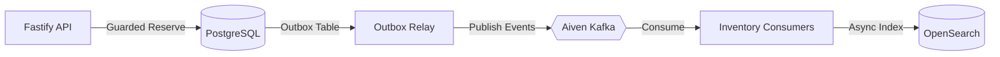

# StockSure API

Backend for StockSure (team DEV BYTES), branch-accurate inventory on Aiven PostgreSQL, Kafka and OpenSearch.
Node 22.18+, TypeScript run natively (no build step), Fastify 5.

Search is a hint, checkout is a guarantee.

## Architecture



The API guarantees zero overselling by executing atomic guarded reserve transactions in PostgreSQL (`on_hand - reserved - buffer >= qty`). Order events are captured via transactional outbox, published by the outbox relay to Kafka, and processed asynchronously by background consumers to synchronize OpenSearch, emit alerts, and finalize stock.

## What each Aiven service does

| Service | Real job |
|---|---|
| PostgreSQL | Source of truth: stock, carts, orders, ledger, outbox, sessions, shelf locations. Guarded reserve = one `UPDATE ... WHERE on_hand - reserved - buffer >= qty`. |
| Kafka | `orders`, `inventory`, `dlq` topics. Order events finalize stock, send notifications, update search and fire back-in-stock alerts. |
| OpenSearch | Fuzzy search with synonyms, filters, one document per product per branch. Falls back to Postgres `pg_trgm` if it is slow or down. |

## Run in 5 steps

Run these commands in order:

```bash
# 1. Apply database migrations (001, 002, 003)
npm run migrate

# 2. Set up Kafka topics (orders, inventory, dlq)
npm run setup:kafka

# 3. Seed 12 branches, 235 products from catalogue.psv, deterministic stock, and index into OpenSearch
npm run seed

# 4. Start the API server in terminal 1
npm run dev

# 5. Start the POS simulator in terminal 2 (sends heartbeats and periodic sales)
npm run pos-sim
```

## Environment Variables

Only variable names are listed. Values must be provided in `.env` (never committed):

- `NODE_ENV`: Environment (`development`, `test`, `production`)
- `PORT`: HTTP server port (default `3000`)
- `CORS_ORIGINS`: Comma-separated allowed CORS origins (default `http://localhost:5173`)
- `DATABASE_URL`: PostgreSQL connection string
- `PG_SSL`: SSL mode (`require` or `off`)
- `PG_CA_B64`: Base64 encoded CA certificate for PostgreSQL (optional if system trust applies)
- `PG_POOL_MAX`: Maximum database pool connections for the API (default `5`). Worker process defaults to `3` (configurable via `WORKER_PG_POOL_MAX`). Aiven free plan limits `max_connections` to 20, so 5 (API) + 3 (worker) + 3 (spare) = 11 keeps connections safely below the 20 limit.
- `KAFKA_BROKERS`: Comma-separated list of Kafka broker host:port
- `KAFKA_CA_B64`: Base64 encoded CA certificate for Kafka
- `KAFKA_CERT_B64`: Base64 encoded client certificate for Kafka (certificate auth)
- `KAFKA_KEY_B64`: Base64 encoded client private key for Kafka (certificate auth)
- `KAFKA_SASL_USERNAME`: Kafka SASL username (SASL auth)
- `KAFKA_SASL_PASSWORD`: Kafka SASL password (SASL auth)
- `KAFKA_SASL_MECHANISM`: SASL mechanism (`scram-sha-256`, `scram-sha-512`, or `plain`)
- `KAFKA_PARTITIONS`: Number of topic partitions (default `2`)
- `KAFKA_CLIENT_ID`: Kafka client identifier (default `stocksure`)
- `OPENSEARCH_URL`: OpenSearch cluster URL including credentials
- `OPENSEARCH_INDEX`: Search index name (default `products_v1`)
- `STAFF_KEY` / `STAFF_API_KEY`: Secret key for staff endpoints
- `ADMIN_TOKEN`: Secret token for admin endpoints
- `HOLD_MINUTES`: Cart reservation hold duration in minutes (default `10`)
- `LOW_STOCK`: Threshold for low stock warning (default `3`)
- `STALE_SECONDS`: Heartbeat freshness threshold in seconds (default `60`)
- `RELAY_INTERVAL_MS`: Outbox relay poll interval in ms (default `400`)
- `SWEEP_INTERVAL_MS`: Cart sweeper interval in ms (default `30000`)
- `SEARCH_TIMEOUT_MS`: OpenSearch query timeout in ms (default `1500`)
- `RUN_RELAY`: Run outbox relay in API process (`true` or `false`)
- `RUN_SWEEPER`: Run cart sweeper in API process (`true` or `false`)
- `DEMO_MODE`: Enable demo shoppers and demo endpoints (`true` or `false`, default `false` in production)
- `DOCS_ENABLED`: Expose Swagger UI at `/docs` in production when set to `true` (default `false` in production, enabled in development)
- `ALLOW_DESTRUCTIVE`: Set to `1` to authorize destructive operations like `npm run seed -- --reset`
- `ZOHO_CLIENT_ID`: Zoho OAuth client ID
- `ZOHO_CLIENT_SECRET`: Zoho OAuth client secret
- `ZOHO_REFRESH_TOKEN`: Zoho OAuth refresh token
- `ZOHO_ORG_ID`: Zoho inventory organization ID
- `ZOHO_ACCOUNTS_URL`: Zoho accounts auth URL (default `https://accounts.zoho.in`)
- `ZOHO_API_URL`: Zoho Inventory API base URL (default `https://www.zohoapis.in/inventory/v1`)

## Why every branch shows CONFIRM_WITH_STORE

A branch with no heartbeat for 60 s is treated as stale (this is the freshness rule working); run `npm run pos-sim` in a second terminal to keep branches fresh.

When a branch's last heartbeat is older than 60 seconds (or has never checked in), the system cannot guarantee that physical in-store purchases have not occurred. To prevent showing customers an outdated "IN_STOCK" guarantee when shelf reality is uncertain, the API transparently transitions stock indicators to `CONFIRM_WITH_STORE`. As soon as the branch POS emits a heartbeat (`POST /pos/heartbeat`) or `npm run pos-sim` runs, the freshness status flips back to `IN_STOCK`. Note that out-of-stock items (`available <= 0`) remain `OUT`.

## Checks

> **CI Note**: `npm run test:db` and `npm run race-test` need real Aiven credentials and write to the real database; they are never run in CI. Continuous integration strictly runs zero-secret checks (`npm run typecheck` and `npm run test:unit`).

| Command | What it proves |
|---|---|
| `npm test` | Pure rules: availability, status, freshness, split plan, search body, event schemas, config errors, catalogue validation, session token hashing, cart codes, `since` filtering, kiosk branch matching. |
| `npm run typecheck` | Strict TypeScript verification across all source and test files (`tsc --noEmit`). |
| `npm run contract:check` | API contract check: verifies all 8 API endpoints against running server with Zod schemas. |
| `npm run race-test` | T1 and T2 over HTTP against the running API (guarded reserve and concurrent holds). |
| `npm run kafka:probe` | Diagnostics probe for Kafka connectivity and connection queue timing. |
| `npm run warmup` | Before demo: wakes all three services and waits until healthy. |
| `npm run pos-sim -- --sales` | Store heartbeats (keeps branches fresh) and random in-store sales. |

## Not built

- **Delivery**: There is no courier integration, dispatch dispatching, or automated inter-branch transfers. `DELIVERY` exists purely as a fulfilment flag on orders and checkout.
- **Zoho Inventory**: The Zoho adapter is fully implemented with OAuth refresh, retry on 401, and simulated fallback, but is not verified against a live Zoho production account.

## Real vs Simulated

| Component | Status | Implementation Details |
|---|---|---|
| **Guarded Reserve** | **REAL** | PostgreSQL row-level locks via atomic `UPDATE inventory SET reserved = reserved + qty WHERE on_hand - reserved - buffer >= qty` with `SERIALIZABLE` isolation. |
| **Transactional Outbox & Kafka** | **REAL** | Outbox pattern with transactional inserts in Postgres, outbox relay polling, and asynchronous consumer finalizing stock and updating OpenSearch. |
| **Search & Synonyms** | **REAL** | OpenSearch custom analyzer with 8 bilingual synonym groups (vernacular Hindi/Kannada, scientific botanical names, typos, English common names). |
| **Real-time Heartbeat Freshness** | **REAL** | Heartbeat timestamp validation (`last_heartbeat_at`) transitioning unrefreshed branches to `CONFIRM_WITH_STORE` after `STALE_SECONDS` (60s). |
| **POS Cash Registers** | *Simulated* | `npm run pos-sim` simulates physical in-store walk-in sales via `POST /pos/sale` and periodic POS heartbeat telemetry. |
| **Inventory Drift** | *Simulated* | Drift and variance between physical stock and digital counts are simulated via `POST /staff/count`. |
| **Cart Abandonment** | *Simulated* | Background sweeper (`sweepOnce`) automatically reclaims unpurchased reservations after `HOLD_MINUTES` (10m). |

## System Limits

- **Single Region Deployment**: All components run within a single Aiven cloud region; there is currently no cross-region active-active replication.
- **In-Memory Rate Limiting**: Route rate limiting uses Fastify in-memory token bucket; rate limits are per-node and not shared across horizontal API replicas.
- **Outbox Consumer Sync vs Async CDC**: Search documents are indexed via transactional outbox worker polling rather than Debezium/Postgres logical decoding CDC.

## How to Run the Judge Demo

Run the automated judge demo test suite which sets up scoped test fixtures and executes all 10 judge criteria:

```bash
# 1. Reset scoped demo fixtures (touches ONLY DEMO-* SKUs)
npm run demo:fixture

# 2. Run the 10-point judge scoreboard
npm run judge-demo
```

## API Endpoints (all JSON)

### Shopper & Storefront
- `GET /health`: Health check (Postgres, Kafka, OpenSearch)
- `POST /session`: Guest session creation returning `{ customer_id, token, name }`
- `GET /branches`: List 12 branches with `lat`, `lng`, and `stock_confirmed`
- `GET /branches/:id/layout`: Pure 3D store layout (dimensions, gondolas, aisles, clearances)
- `GET /branches/:id/shelves?since=<ISO>`: Shelf locations and live stock status (supports differential polling via `since`)
- `POST /cart/code`: Generate 8-character kiosk transfer code (unambiguous alphabet, 30m TTL)
- `GET /kiosk/cart/:code?branch_id=`: Retrieve cart at kiosk with `at_this_branch` flags
- `GET|POST|PATCH|DELETE /cart` and `/cart/items`: Shopping cart operations
- `POST /checkout`: Guarded reserve checkout (`fulfilment: 'PICKUP' | 'DELIVERY' | 'IN_STORE'`)
- `POST /orders/:id/pay`, `POST /orders/:id/cancel`, `GET /orders/:id`, `GET /orders/:id/rescue`
- `POST /rescue/apply`: Apply Rescue Ladder alternative when stock is lost
- `POST /requests`: Upsert product search request count

### Staff & POS
- `POST /staff/products`: Add new product (flag `i`), assign shelf by appending, index in OpenSearch
- `POST /pos/sale`: Register in-store POS sale
- `POST /staff/count`: Inventory count reconciliation
- `POST /staff/restock`: Restock on-hand inventory
- `POST /pos/heartbeat`: Branch heartbeat ping

### Proof & Admin
- `GET /demo/pipeline`: Pipeline health and outbox/finalizer metrics
- `GET /demo/proof/:orderId`: Audit proof verifying Postgres, Kafka, and OpenSearch synchronization
- `GET /demo/events`: Event stream history
- `POST /admin/replay-dlq`: Replay dead letter queue events
- `POST /admin/reindex`: Reindex OpenSearch documents from database
